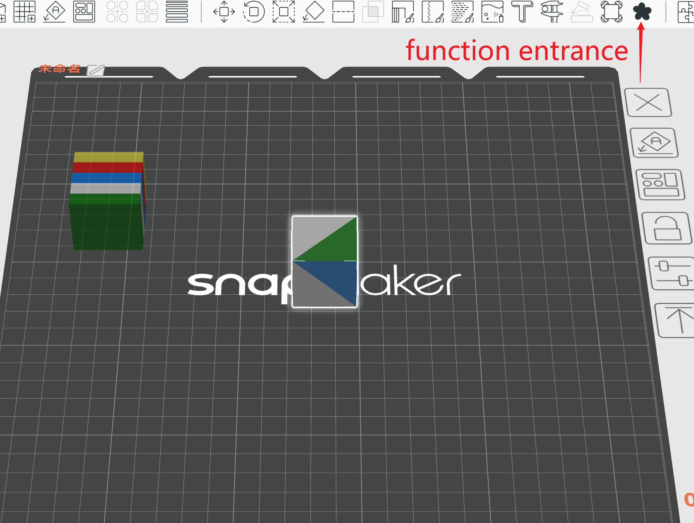
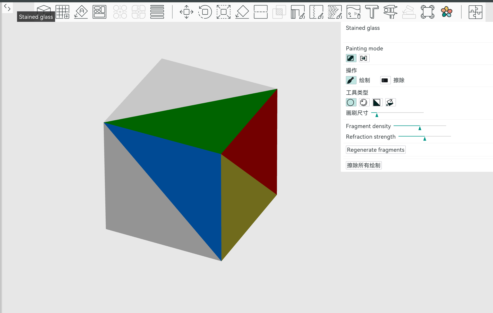
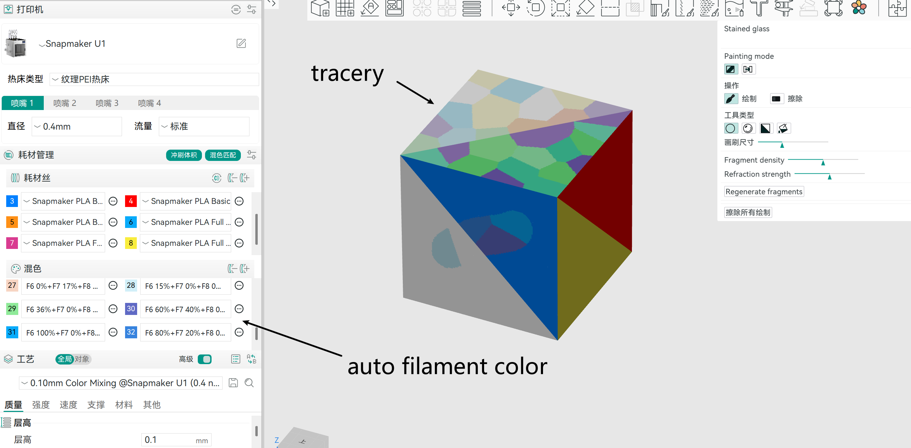
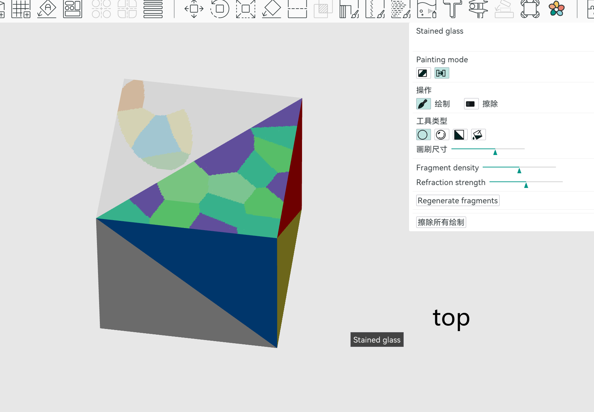
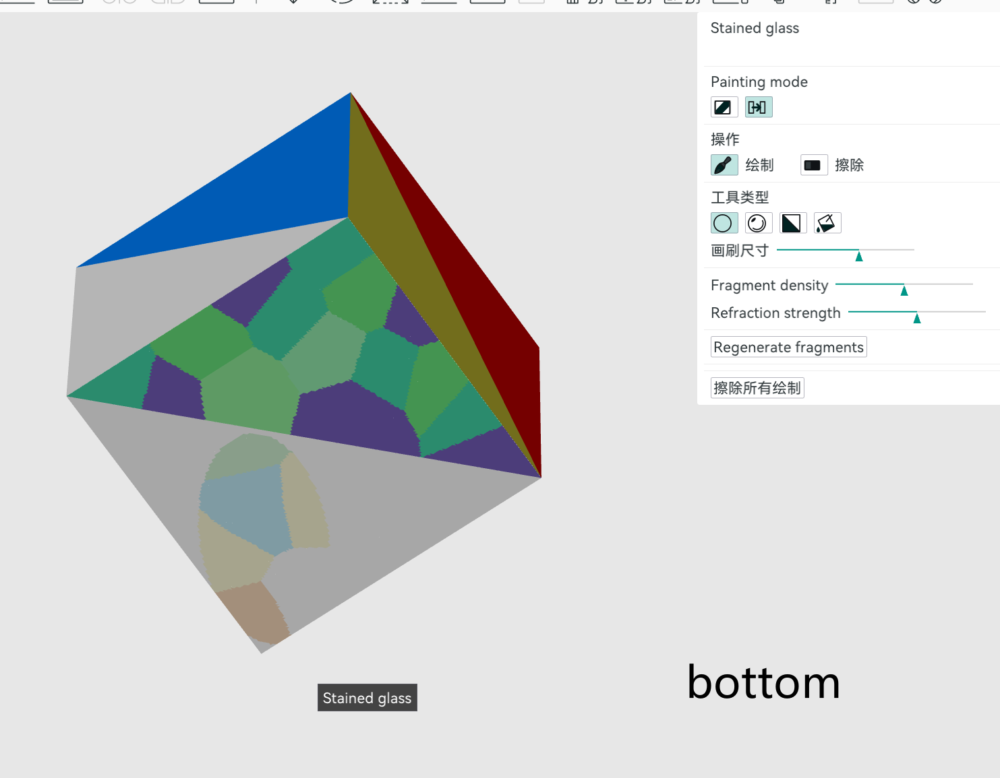
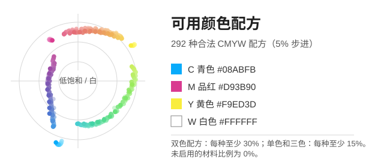
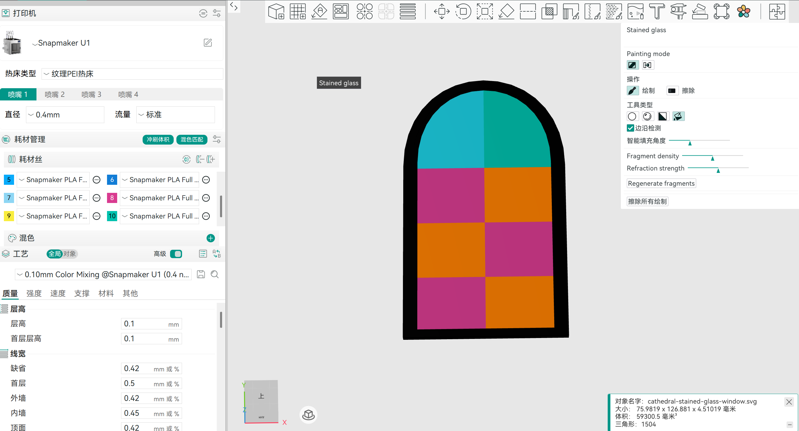
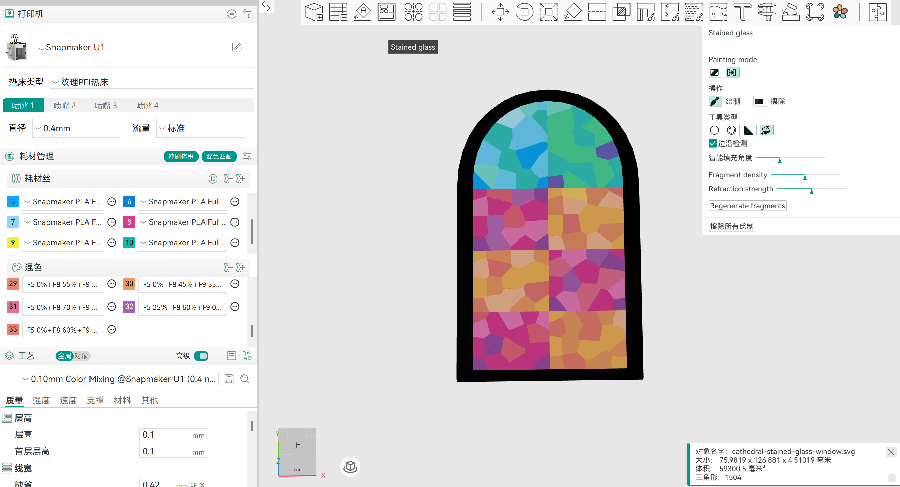
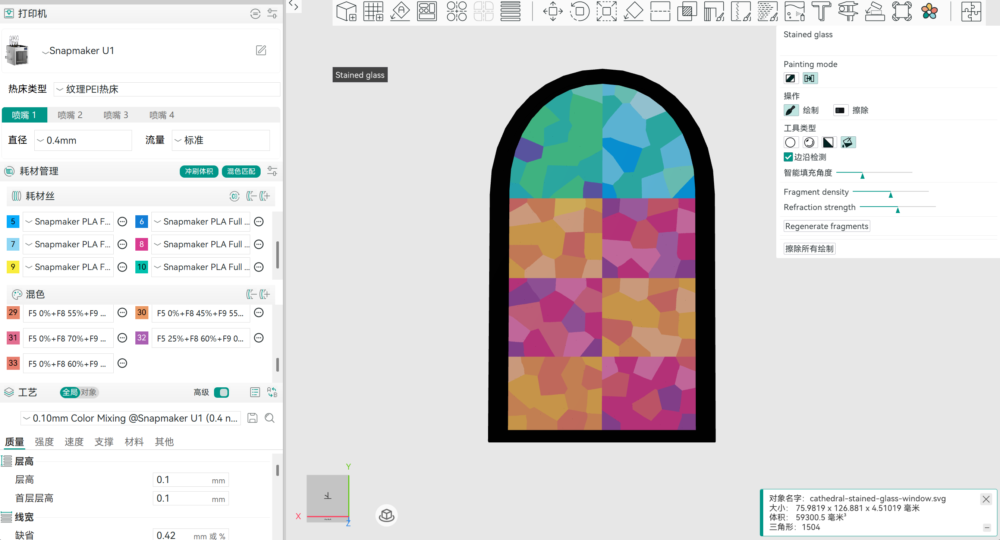
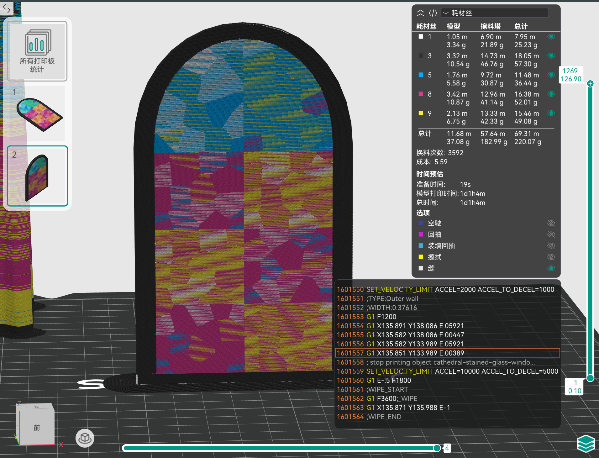

<p>
  
</p>

# Tracery Slicer

[English](README.md) | [简体中文](README.zh-CN.md)

## Demo Video

https://github.com/user-attachments/assets/e6fdc4cc-ae38-4ae3-8331-5e7b8f4c67ab

Click the play button above to watch a walkthrough of the stained-glass tool (about 3 minutes 16 seconds).

The name comes from *tracery*, the framework of a church's stained-glass windows, reflecting the tool's purpose of creating stained-glass effects.

Tracery Slicer is an FDM slicing tool for creating stained-glass effects. Paint an area on a model to automatically generate colorful fragments and apply them as multi-material painting data that can be sliced.

For now, development is focused solely on this feature; whether other features will be added is undecided. I use a Snapmaker U1 printer, so I forked [Snapmaker Orca](https://github.com/Snapmaker/OrcaSlicer) and implemented the feature directly in that codebase.

This project is under development, and printed results are still being tested. If you are interested, give it a try and share your feedback. I hope you enjoy the possibilities of multicolor printing.

Test prints are in progress. Automatic stained-glass color generation is also being tested and refined through printing.

## Opening the Tool

Import and select a model, then click the **flower icon** in the top toolbar to open the **Stained glass** panel.

| Toolbar Location | Stained Glass Settings |
| :---: | :---: |
| [](doc/images/tracery-entry-location.png) | [](doc/images/tracery-entry.png) |

The panel includes Normal Mode and Through Mode, painting tools, brush size, fragment density, and regeneration controls. Screenshots are shared with the Chinese README and may contain Chinese interface text.

## Stained Glass Features

Paint an area on the model to generate irregular colored fragments resembling a stained-glass mosaic. Adjust fragment density to change the pattern. Colors are matched using CMYW (cyan, magenta, yellow, and white) mixing recipes, with mixed-material slots added automatically.

### Normal Mode and Through Mode

| Normal Mode | Through Mode |
| --- | --- |
| **Behavior:** Paints stained-glass regions on the currently visible surface. | **Behavior:** Maps stained-glass coloring to the front and corresponding back surface of the model. |
| **Use case:** Single-sided coloring or local decoration. | **Use case:** Regions that need corresponding patterns on both sides. |
| [](doc/images/tracery-normal-mode.png) | [](doc/images/tracery-through-top.png) [](doc/images/tracery-through-bottom.png) |

Newly selected regions can use different modes. For example, paint region A in Normal Mode, then region B in Through Mode: A keeps its Normal Mode behavior, while B uses Through Mode. The reverse order works the same way.

“Through” refers to mapping colors onto both sides. It does not cut holes in the model or automatically make the material transparent. Actual light transmission depends on the filament, model thickness, and print settings.

### Available Recipes for Automatic Color Matching



Stained glass uses a fixed CMYW palette: C (cyan), M (magenta), Y (yellow), and W (white). Black is excluded from stained-glass color calculations.

### Example

A four-panel comparison of the same model: original colors, the front and back in Through Mode, and the sliced preview.

| Original Colors | Through Mode · Front |
| :---: | :---: |
| [](doc/images/tracery-case-original.png) | [](doc/images/tracery-case-through-front.png) |
| **Through Mode · Back** | **Sliced Preview** |
| [](doc/images/tracery-case-through-back.png) | [](doc/images/tracery-case-sliced.png) |

Click an image to view the original. The sliced view is a preview; actual printed results depend on the filament, model, and print settings.


## Basic Workflow

1. Import a model and choose your printer and filament profiles.
2. Select the model and open the stained-glass tool using the colored flower icon in the top toolbar.
3. Choose Normal Mode or Through Mode, then set the painting tool and brush size.
4. Paint the first region to generate a stained-glass pattern.
5. Switch modes as needed and continue painting. Newly selected areas are generated incrementally, with local color transitions where regions meet.
6. Check both sides, mixing recipes, and material slots, then slice the model and inspect the print preview.

Stained-glass and color-mixing features are still evolving.

## Source Code and Installation

Repository: [Cosmo991119/Tracery_slicer](https://github.com/Cosmo991119/Tracery_slicer).

To clone the current development branch:

```bash
git clone --branch fix-tracery https://github.com/Cosmo991119/Tracery_slicer.git
cd Tracery_slicer
git lfs install
git lfs pull
```

Access to a private repository requires an authorized GitHub account. If you already have a local checkout, you do not need to clone it again; check that you are on the branch you intend to build.

If project builds are available, check [this repository's Releases page](https://github.com/Cosmo991119/Tracery_slicer/releases). Otherwise, build from source using the instructions below. [Upstream Snapmaker Orca releases](https://github.com/Snapmaker/OrcaSlicer/releases) are not equivalent to builds containing this branch's stained-glass changes.

When installing or running a build:

- **Windows:** Use the corresponding installer or portable directory. Runtime components include Microsoft WebView2 and the Visual C++ runtime.
- **macOS:** Choose the application package for your processor: `arm64` for Apple Silicon or `x86_64` for Intel. Drag the application into the Applications folder.
- **Linux:** Make an AppImage executable before running it, for example `chmod +x ./Snapmaker_Orca_Linux.AppImage`. Use the actual filename of your build.

## How to Build

Run all commands below from the repository root. The project uses C++17 and CMake. Platform scripts handle dependency builds and the main configuration. The first build needs internet access to download dependencies, as well as sufficient disk space, memory, and time.

The current Windows configuration and Linux build script reject CMake 4.x. The Linux script recommends CMake 3.28.x–3.30.x. Choose a CMake 3.x version compatible with this repository's scripts rather than assuming the latest version will work.

### Windows 64-bit (Visual Studio 2022)

Prerequisites:

- Visual Studio 2022 with the **Desktop development with C++** workload and a Windows SDK.
- CMake 3.x, Git, Git LFS, and Strawberry Perl, available from your command prompt.
- Run `git lfs pull` after cloning to retrieve any LFS files needed for the build.

Open **x64 Native Tools Command Prompt for VS 2022**, change to the repository root, and run:

```bat
build_release_vs2022.bat
```

By default, the script builds the dependencies and application in Release mode, then installs into `build\Snapmaker_Orca`.

Common options:

```bat
REM Build dependencies only
build_release_vs2022.bat deps

REM Build the application only, using matching existing dependencies
build_release_vs2022.bat slicer

REM Build a Debug version, including matching dependencies
build_release_vs2022.bat debug

REM Build with debug information
build_release_vs2022.bat debuginfo
```

Debug builds use `build-dbg`, while builds with debug information use `build-dbginfo`. Do not reuse incompatible dependencies or CMake caches when switching compilers or configurations.

For Visual Studio 2019, the repository retains `build_release.bat`. Run it from **x64 Native Tools Command Prompt for VS 2019**. This script contains a fixed Windows SDK path, so check it against your installed SDK before use.

If CMake warns about Strawberry Perl's path priority, make sure your chosen CMake directory appears before Strawberry Perl's `c\bin` in `PATH`.

### macOS (Apple Silicon / Intel)

Install Xcode and its command-line tools, a compatible CMake 3.x version, Git, Git LFS, gettext, libtool, automake, autoconf, and texinfo. You can install the additional helper tools with Homebrew:

```bash
brew install gettext libtool automake autoconf texinfo
```

Build the dependencies and application for the current machine's architecture:

```bash
bash build_release_macos.sh
```

Alternatively, choose one of these commands to specify the architecture:

```bash
bash build_release_macos.sh -a arm64
bash build_release_macos.sh -a x86_64
```

To build in separate stages:

```bash
bash build_release_macos.sh -d
bash build_release_macos.sh -s
```

The default generator is Xcode. Build files are placed in `build/<architecture>`, and the packaged application is located at `build/<architecture>/Snapmaker_Orca/Snapmaker Orca.app`.

To debug in Xcode, first run `bash build_release_macos.sh -c RelWithDebInfo`. Open `Snapmaker_Orca.xcodeproj` in the corresponding build directory, select the `Snapmaker_Orca` scheme, set Run → Build Configuration to `RelWithDebInfo`, and run the application. To follow the upstream debugging setup, you can also uncheck `Allow debugging when browsing versions` under Run → Options.

The script supports `-x` to use Ninja. Install Ninja separately and use a separate or reconfigured build directory to avoid mixing it with an existing Xcode cache. See `bash build_release_macos.sh -h` for more options.

### Linux (Ubuntu / Debian-based Example)

Install Git, Git LFS, and a compatible CMake 3.x version, then install system dependencies:

```bash
sudo bash build_linux.sh -u
```

Download and build dependencies, compile the application, and create an AppImage:

```bash
bash build_linux.sh -dsi
```

If you do not need an AppImage:

```bash
bash build_linux.sh -ds
```

To rebuild only the application after matching dependencies are available:

```bash
bash build_linux.sh -s
```

Use `-j N` to limit parallel build jobs, for example `bash build_linux.sh -ds -j 4`. System dependencies are handled by distribution-specific scripts in `scripts/linux.d/`. Distributions without a matching script require manual dependency setup.

The script is named **`build_linux.sh`**; filenames are case-sensitive on Linux. See `bash build_linux.sh -h` for more options.

### Build Troubleshooting

- **Dependency download failures:** Check network access and the download logs. Finish building dependencies before building the application.
- **Compiler or SDK not found:** On Windows, use the developer command prompt for your Visual Studio version. On macOS, check the Xcode command-line tools configuration.
- **CMake version or generator mismatch:** Check the versions supported by the scripts. Do not mix Visual Studio, Xcode, and Ninja generators in the same build directory.
- **Insufficient build memory:** Reduce the number of parallel jobs rather than bypassing resource checks.

## Klipper Configuration Reference

If your slicing settings use object exclusion or arc commands, make sure the corresponding features are enabled on the printer. The following reference configuration is retained from the upstream README. Add it to `printer.cfg` as needed, without duplicating existing sections:

```ini
[exclude_object]

[gcode_arcs]
resolution: 0.1
```

## Upstream Projects and Acknowledgments

Tracery Slicer is derived from **Snapmaker Orca**, retaining its slicing capabilities while adding stained-glass and color-mixing features.

Project lineage and related projects:

- [Snapmaker Orca](https://github.com/Snapmaker/OrcaSlicer): this project's direct upstream, based on OrcaSlicer.
- [OrcaSlicer](https://github.com/SoftFever/OrcaSlicer): derived from Bambu Studio, previously known as BambuStudio-SoftFever.
- [Bambu Studio](https://github.com/bambulab/BambuStudio): based on PrusaSlicer.
- [PrusaSlicer](https://github.com/prusa3d/PrusaSlicer): derived from Slic3r, developed by Alessandro Ranellucci and the RepRap community.
- [Slic3r](https://github.com/Slic3r/Slic3r): a foundational project in this lineage.
- [SuperSlicer](https://github.com/supermerill/SuperSlicer): a source of some OrcaSlicer features.

Thanks to all upstream projects and contributors. The original README's attribution is retained: the OrcaSlicer logo was designed by community member Justin Levine (@freejstnalxndr). Tracery Slicer is an independent derivative project, not an official release of any of the projects above.

## License

This project retains the **GNU Affero General Public License v3 (AGPL-3.0)**. See [LICENSE.txt](LICENSE.txt) for the full text. Preserve upstream copyright notices and third-party license files; the terms accompanying each component apply to that component.

Retained third-party notices:

- The pressure advance calibration pattern is adapted from Andrew Ellis' generator (GPL v3), which was itself adapted from Sineos' generator for Marlin (GPL v3).
- The optional Bambu networking plugin depends on non-free libraries from BambuLab and extends support for Bambu printers. Its licensing is separate from the main application.

## Feedback and Contributions

Report issues or suggestions about this branch's stained-glass features in [this repository's Issues](https://github.com/Cosmo991119/Tracery_slicer/issues). Include reproduction steps, screenshots, relevant model characteristics, and the commit you are using. Access to a private repository and its issue tracker requires permission.

Before contributing code, read the [repository guidelines](AGENTS.md). Do not include account credentials, printer passwords, or other sensitive information in reports or project files.
