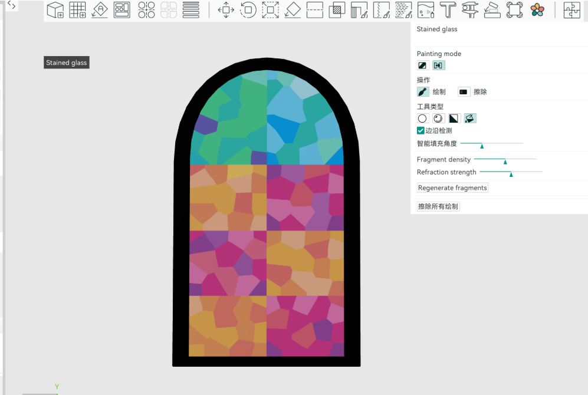
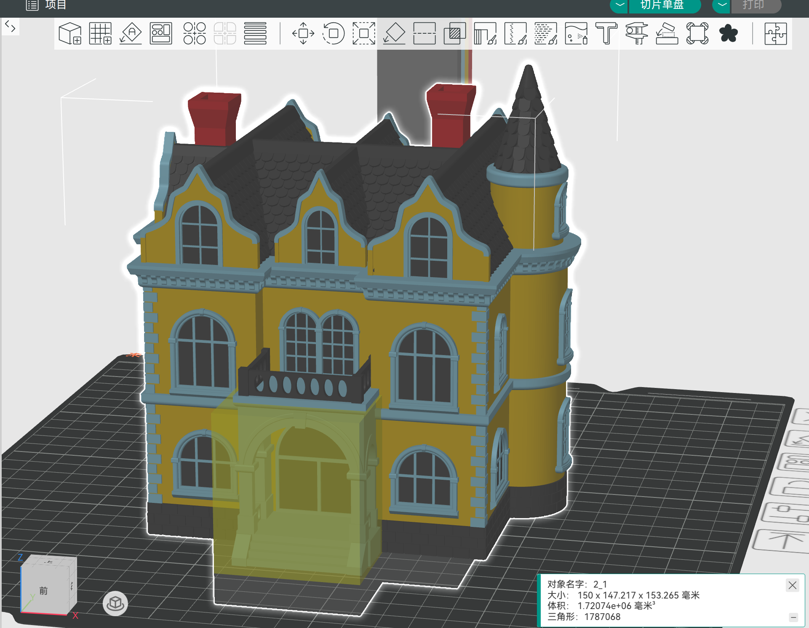
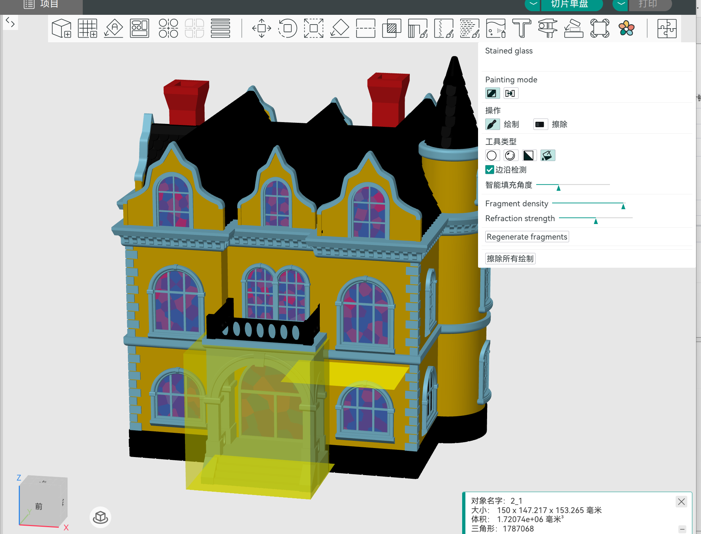

<p>
  
</p>

# Tracery Slicer 中文介绍

[English](README.md) | [简体中文](README.zh-CN.md)

[](doc/images/tracery-feature-preview.png)

Tracery Slicer 是一个生成花窗特殊效果FDM 切片工具，通过涂选模型表面自动生成彩色碎片，并将结果应用为可参与切片的多材料着色数据。

暂时确认只实现这个功能，不确定以后是否会扩展其它功能。因为我使用snapmaker 的U1打印机，所以我的代码分支从 [Snapmaker Orca](https://github.com/Snapmaker/OrcaSlicer) 拉取并直接实现

正在开发中，已知面积较大时候时花窗生成速度较慢。

测试数据打印中。

花窗颜色自动化功能打印调试中。

## 功能入口

导入并选中模型后，点击顶部工具栏中的**花朵图标**，打开 **Stained glass（花窗）** 面板。

| 功能入口位置 | 花窗设置面板 |
| :---: | :---: |
| [](doc/images/tracery-entry-location.png) | [](doc/images/tracery-entry.png) |


面板提供普通／穿透模式、绘制工具、画刷尺寸、碎片密度和重新生成等选项。

## 花窗功能

在模型表面涂选区域后，工具会生成不规则彩色碎片，形成类似彩色玻璃拼接的图案。可通过碎片密度调整图案效果，并使用 CMYW（青、品红、黄、白）混色配方进行颜色匹配，自动添加混色材料槽位。

### 普通模式与穿透模式

| 普通模式（Normal） | 穿透模式（Through） |
| --- | --- |
| **作用：** 在当前可见表面绘制花窗区域 | **作用：** 将花窗着色映射到模型正面及对应背面 |
| **适用场景：** 只需要单面着色或局部装饰 | **适用场景：** 需要双面对应图案的区域 |
| [](doc/images/tracery-normal-mode.png) | [](doc/images/tracery-through-top.png) [](doc/images/tracery-through-bottom.png) |

不同新增选区可以使用不同模式。例如，先用普通模式绘制 A 区，再用穿透模式绘制 B 区，A 区保留普通模式，B 区使用穿透模式；反过来操作同理。

“穿透”指双面着色映射，不是给模型打孔，也不代表材料会自动变为透明。实际透光效果取决于耗材、模型厚度和打印参数。

### 自动化配色可用颜色配方


花窗使用固定的 CMYW 基础颜色：C（青色）、M（品红）、Y（黄色）与 W（白色）。当前可用配方以 5% 为步进。双色配方中每种颜色至少占 30%；三色配方中每种颜色至少占 15%，且必须由白色与两种 CMY 颜色组成。单色配方为该颜色占 100%，未参与的颜色占 0%。生成碎片颜色时，系统从这些可用组合中匹配目标显色，并优先选择兼顾颜色误差和配比均衡性的方案。

### 案例演示

同一模型的原始配色、穿透模式正反面与切片效果，以四宫格对照展示。

| 原始色 | 穿透模式 · 正面 |
| :---: | :---: |
| [](doc/images/tracery-case-original.png) | [](doc/images/tracery-case-through-front.png) |
| **穿透模式 · 背面** | **切片效果** |
| [](doc/images/tracery-case-through-back.png) | [](doc/images/tracery-case-sliced.png) |

点击图片可查看原图。图中为切片预览，实际打印效果以耗材、模型及打印参数为准。

### 案例演示：建筑模型花窗

建筑模型添加花窗前后的效果对照，展示窗户区域的彩色碎片图案。

| 原始效果 | 添加花窗后 |
| :---: | :---: |
| [](doc/images/tracery-building-before.png) | [](doc/images/tracery-building-after.png) |

点击图片可查看原图。

## 基本使用流程

1. 导入模型，选择打印机与耗材配置。
2. 选中模型，通过顶部彩色花朵图标打开花窗工具。
3. 选择普通模式或穿透模式，设置绘制工具与画刷尺寸。
4. 在模型上涂选第一块区域，生成花窗图案。
5. 按需要切换模式并继续涂选，新增部分增量生成，相接区域进行局部颜色过渡。
6. 检查正反面着色、混色配方与材料槽位，再进行切片并查看打印预览。

花窗与混色功能仍在迭代中。

## 获取源码与安装

项目仓库：[Cosmo991119/Tracery_slicer](https://github.com/Cosmo991119/Tracery_slicer)。

首次获取当前开发分支：

```bash
git clone --branch fix-tracery https://github.com/Cosmo991119/Tracery_slicer.git
cd Tracery_slicer
git lfs install
git lfs pull
```

私有仓库需要使用有访问权限的 GitHub 账号。已有本地仓库无需重复克隆，编译前确认位于需要构建的分支即可。

如果本项目提供构建产物，可在[本仓库 Releases 页面](https://github.com/Cosmo991119/Tracery_slicer/releases)查看；没有对应安装包时，请按下方说明从源码编译。[上游 Snapmaker Orca 发布版](https://github.com/Snapmaker/OrcaSlicer/releases)不等同于包含本分支花窗改动的版本。

安装或运行构建产物时：

- **Windows**：使用对应安装包或便携目录；运行所需组件包括 Microsoft WebView2 与 Visual C++ 运行库。
- **macOS**：使用与处理器匹配的应用包，Apple Silicon 对应 `arm64`，Intel 对应 `x86_64`，将应用拖入“应用程序”目录。
- **Linux**：使用 AppImage 时，先赋予执行权限，例如 `chmod +x ./Snapmaker_Orca_Linux.AppImage`；文件名以实际产物为准。

## 如何编译

以下命令均从仓库根目录执行。项目采用 C++17 与 CMake，平台脚本会处理依赖构建和主要配置；首次编译需要联网下载依赖，并预留足够的磁盘、内存和时间。

当前 Windows 配置与 Linux 构建脚本会拒绝 CMake 4.x。Linux 脚本建议使用 CMake 3.28.x–3.30.x；准备环境时应选择与本仓库脚本兼容的 CMake 3.x，不要直接假设最新版本可用。

### Windows 64 位（Visual Studio 2022）

准备工具：

- Visual Studio 2022，安装“使用 C++ 的桌面开发”工作负载及 Windows SDK。
- CMake 3.x、Git、Git LFS、Strawberry Perl，并确保命令可在终端中使用。
- 克隆后执行 `git lfs pull`，获取构建所需的 LFS 文件。

打开 **x64 Native Tools Command Prompt for VS 2022**，进入仓库根目录，执行：

```bat
build_release_vs2022.bat
```

脚本默认构建 Release 依赖和主程序，并安装到 `build\Snapmaker_Orca`。

常用选项：

```bat
REM 只构建依赖
build_release_vs2022.bat deps

REM 已有匹配的依赖时，只构建主程序
build_release_vs2022.bat slicer

REM 构建调试版本（包含对应依赖）
build_release_vs2022.bat debug

REM 构建带调试信息的版本
build_release_vs2022.bat debuginfo
```

Debug 与带调试信息的构建分别使用 `build-dbg`、`build-dbginfo` 目录。切换编译器或配置时，不能直接混用不匹配的依赖和 CMake 缓存。

如果使用 Visual Studio 2019，仓库仍保留 `build_release.bat`，应从对应的 **x64 Native Tools Command Prompt for VS 2019** 运行；该脚本包含固定 Windows SDK 路径，使用前需核对本机 SDK。

如果 CMake 提示 Strawberry Perl 的路径优先级问题，请确保所选 CMake 的目录位于 Strawberry Perl 的 `c\bin` 之前。

### macOS（Apple Silicon / Intel）

准备 Xcode 及命令行工具、兼容的 CMake 3.x、Git、Git LFS，以及 gettext、libtool、automake、autoconf、texinfo。其余辅助工具可通过 Homebrew 安装：

```bash
brew install gettext libtool automake autoconf texinfo
```

默认使用当前机器架构，构建依赖和主程序：

```bash
bash build_release_macos.sh
```

也可以明确指定架构，选择其中一条：

```bash
bash build_release_macos.sh -a arm64
bash build_release_macos.sh -a x86_64
```

分步构建：

```bash
bash build_release_macos.sh -d
bash build_release_macos.sh -s
```

默认使用 Xcode 生成器，构建目录为 `build/<架构>`，打包后的应用位于 `build/<架构>/Snapmaker_Orca/Snapmaker Orca.app`。

需要 Xcode 调试时，可先执行 `bash build_release_macos.sh -c RelWithDebInfo`，再打开对应构建目录中的 `Snapmaker_Orca.xcodeproj`，选择 `Snapmaker_Orca` Scheme，将 Run 的 Build Configuration 设置为 `RelWithDebInfo` 后运行。如果需要沿用上游调试设置，可在 Run → Options 中取消勾选 `Allow debugging when browsing versions`。

脚本也支持 `-x` 使用 Ninja；需另行安装 Ninja，并在独立或已重新配置的构建目录中使用，避免与已有 Xcode 缓存混用。更多参数见 `bash build_release_macos.sh -h`。

### Linux（以 Ubuntu / Debian 系为例）

准备 Git、Git LFS 及兼容的 CMake 3.x，然后安装系统依赖：

```bash
sudo bash build_linux.sh -u
```

下载并构建依赖、编译主程序、生成 AppImage：

```bash
bash build_linux.sh -dsi
```

不需要 AppImage 时，可使用：

```bash
bash build_linux.sh -ds
```

已有匹配的依赖后，仅重新编译主程序：

```bash
bash build_linux.sh -s
```

脚本支持 `-j N` 限制并行任务数量，例如 `bash build_linux.sh -ds -j 4`。系统依赖按 `scripts/linux.d/` 中的发行版脚本处理；未覆盖的发行版需要自行适配依赖。

注意脚本名是 **`build_linux.sh`**，Linux 文件名区分大小写。更多参数见 `bash build_linux.sh -h`。

### 编译排查

- **依赖下载失败**：检查网络和依赖下载日志，完成依赖构建后再构建主程序。
- **找不到编译器或 SDK**：Windows 使用对应版本的 VS 开发者命令提示符；macOS 检查 Xcode 命令行工具配置。
- **CMake 版本或生成器不匹配**：核对脚本支持的版本，不要在同一构建目录混用 Visual Studio、Xcode、Ninja 等生成器。
- **构建内存不足**：降低并行任务数，不建议直接跳过资源检查。

## Klipper 配置参考

使用需要对象排除或圆弧指令的切片配置时，请确认打印机端已启用对应功能。上游 README 中的参考配置保留如下，按需加入 `printer.cfg`，不要重复添加已有配置节：

```ini
[exclude_object]

[gcode_arcs]
resolution: 0.1
```

## 上游来源与致谢

Tracery Slicer 基于 **Snapmaker Orca** 进行二次开发，保留上游切片能力，并在此基础上开发花窗与混色相关功能。

主要项目来源：

- [Snapmaker Orca](https://github.com/Snapmaker/OrcaSlicer)：本项目直接上游，基于 OrcaSlicer。
- [OrcaSlicer](https://github.com/SoftFever/OrcaSlicer)：源自 Bambu Studio，早期称为 BambuStudio-SoftFever。
- [Bambu Studio](https://github.com/bambulab/BambuStudio)：基于 PrusaSlicer。
- [PrusaSlicer](https://github.com/prusa3d/PrusaSlicer)：源自 Alessandro Ranellucci 与 RepRap 社区开发的 Slic3r。
- [Slic3r](https://github.com/Slic3r/Slic3r)：上述项目的重要基础。
- [SuperSlicer](https://github.com/supermerill/SuperSlicer)：OrcaSlicer 的部分功能来源。

感谢上游项目及所有贡献者。保留原 README 中的署名：OrcaSlicer 标志由社区成员 Justin Levine（@freejstnalxndr）设计。Tracery Slicer 是独立衍生项目，不代表上述项目的官方发行版。

## 许可证

本项目沿用 **GNU Affero General Public License v3（AGPL-3.0）**，完整文本见 [LICENSE.txt](LICENSE.txt)。上游版权声明及第三方组件的许可证应一并保留，具体适用条款以各组件随附文件为准。

原有第三方说明：

- 压力提前校准图案改编自 Andrew Ellis 的生成器（GPL v3）；该生成器又改编自 Sineos 为 Marlin 开发的生成器（GPL v3）。
- Bambu 网络插件依赖 BambuLab 的非自由库，是可选组件，用于扩展 Bambu 打印机相关功能，其许可与主程序区分。

## 反馈与贡献

与本分支花窗功能相关的问题或建议，可提交至[本仓库 Issues](https://github.com/Cosmo991119/Tracery_slicer/issues)，并附上复现步骤、截图、模型特征及所用提交版本。私有仓库的访问和反馈需要相应权限。

贡献代码前请阅读仓库中的 [开发约定](AGENTS.md)，并避免在问题报告或项目文件中包含账号凭据、打印机密码等敏感信息。
